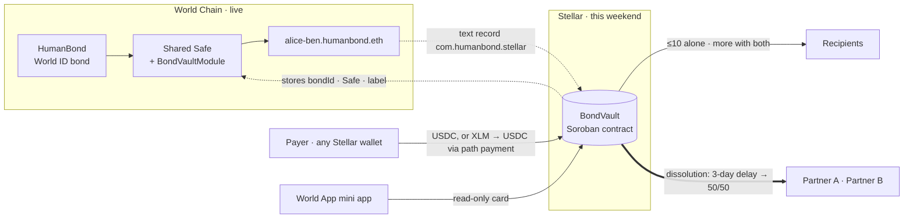

# HumanBond on Stellar — HackMeridian Lisbon 2026

**Path:** Scale (Prototype → Product) · **Event:** 25–26 Oct 2026, Warehouse ONE16, Lisbon
**Status:** working on Stellar **testnet**. Contract not audited. Details on what is real and what is not are at the end.

> **A couple's shared money, with rules both of them wrote — now on Stellar.**
> Small things, either of you. Big things, both of you. If it ends, half each.

---

## The problem

When two people share a life, their money lives in systems that don't know the relationship exists: two separate accounts, or one joint account where either person can empty it. Nothing in between. The partner who does the unpaid work — care, the home — has no standing in either.

## What HumanBond is (before this weekend)

A proof-of-humanity partnership protocol, **live on World Chain mainnet** and in the World App store. Two World ID–verified humans form an on-chain bond. Each bond gets a **shared wallet** (a 2-of-2 Safe plus our `BondVaultModule`) and an ENS name like `alice-ben.humanbond.eth`:

- either partner can spend **small** amounts alone (≤ 10 USDC, max 25 USDC per rolling 24h, shared)
- anything larger needs **both** partners
- if the bond is dissolved, the wallet **splits 50/50**

## What we built at HackMeridian

We brought the shared wallet to Stellar, with the same rules, as a Soroban contract.

| | Built this weekend |
|---|---|
| **BondVault** Soroban contract | One instance per bond. Same rules as the EVM module: solo small spends inside a rolling daily budget, two-partner approval above it, cancel by either, dissolution with a 3-day delay then a permissionless 50/50 split. 20 unit tests. |
| **Pay page** `/pay/<label>` | Anyone pays the couple's vault. Has USDC → one transfer. Has XLM or another asset → Stellar's built-in exchange converts to the exact USDC amount, then transfers. |
| **Vault page** `/stellar/<label>` | Partners spend, approve, decline, request or cancel dissolution, and split, with any Stellar wallet (Stellar Wallets Kit: Freighter, xBull, Lobstr, Albedo…). |
| **Create page** `/stellar` | Reads the real bond from World Chain (Safe address, ENS label) and deploys the couple's vault with that link baked into the contract. |
| **World App card** on `/vault` | Read-only view of the Stellar vault inside the existing mini app: balance, today's budget, pending approvals, pay link. |
| **Inheritance** (will + proof of life) | Both partners co-sign a will (heirs, shares, optional unlock dates). Every signed action is a check-in; a missed check-in can be reported, a challenge window lets the partner answer, then anyone can confirm the death. First death: the survivor owns the vault and the will is locked. Second death: heirs claim their shares. |
| **Name → vault trust** | A name only resolves to a vault if World Chain points back (ENS text record `com.humanbond.stellar`, plus the vault's stored Safe must match). Stops squatters from catching a couple's payments. |
| **Testnet scripts** | `stellar:smoke` runs the whole lifecycle headless; `stellar:demo-seed` creates a live demo vault. |



## How it works — the contract spec

`contracts-stellar/contracts/bond-vault/src/lib.rs`

| Function | Who | What |
|---|---|---|
| `__constructor(partner_a, partner_b, token, bond_id, safe, label, small_spend_threshold, daily_free_limit, dissolution_delay)` | deployer | Bounds: threshold ≤ 100 USDC, daily ≤ 250 USDC (the EVM module's hard caps), delay 1 s – 30 days, partners distinct. Immutable after. |
| `propose_spend(proposer, to, amount)` | a partner | Executes immediately if `amount ≤ threshold` and fits the rolling 24h budget (shared by both). Otherwise pending, proposer's approval recorded. |
| `approve_spend(approver, id)` | the other partner | Executes when both approved. Proposer cannot approve twice. Blocked after dissolution. |
| `cancel_spend(caller, id)` | either partner | "No, and stop asking." |
| `request_dissolution(requester)` | a partner | Starts the delay. Spending still works meanwhile, as on World Chain. |
| `cancel_dissolution(requester)` | requester only | Only while the delay runs. After it, the outcome is fixed. |
| `execute_dissolution()` | **anyone** | After the delay: closes the vault and **books** each partner's half (odd unit to B). Moves no tokens. Callable again later to book late arrivals, so money is never trapped. |
| `claim_share(partner)` | **anyone** | Pays a partner their booked half. Can only ever pay that partner. If one partner can't receive (no USDC trustline, frozen), only their own claim fails — the other's half still goes out. |
| `rescue(token, to, amount)` | **both partners** | Moves any token *other than* USDC out of the vault (e.g. XLM sent by mistake). Refuses USDC, which only leaves by the spend rules or the split. |
| `set_will(heirs)` | **both partners** | Up to 10 heirs, shares in basis points summing to 100%, optional unlock time per heir (a minor's share can wait for a date). An heir can be an account or a contract — another bond's vault. Only while both are alive, so the will locks at the first death. |
| `heartbeat(partner)` | that partner | Proof of life for quiet periods. Every other signed partner action counts as a check-in too. |
| `report_lapse(partner)` | **anyone** | After `heartbeat_interval` (default 90 days) without a check-in. Opens the challenge window; any check-in by that partner cancels it. |
| `confirm_death(partner)` | **anyone** | After the challenge window (default 30 days) passes unanswered. First death: survivor owns the vault (spends of any size on one signature), pending dissolution ends. Second death: the estate is booked to the heirs. |
| `claim_inheritance(heir)` | **anyone** | Pays an heir their booked share once its unlock time has passed. Only ever pays that heir. `book_late_estate()` books later arrivals. |
| `config / balance / remaining_free_allowance / get_spend / spend_count / dissolution / is_dissolved / owed / will / last_seen / lapse / is_deceased / estate_owed` | anyone | Views. |

Paying in needs no contract function: it is a plain transfer on the USDC Stellar Asset Contract to the vault's address.

### Stellar features used

- **Soroban** contract with constructor, `require_auth`, typed errors and events
- **Stellar Asset Contract** for USDC (Circle) held by a contract
- **Path payments** (strict receive) through the built-in DEX / AMM pools: pay in XLM, the couple receives exact USDC
- **Stellar RPC** simulation and assembly; **Horizon** for classic paths and balances
- **Stellar Wallets Kit** for multi-wallet signing

## Try it (testnet)

| | |
|---|---|
| Vault wasm (testnet) | `3c68437d5b37def506d7bba542b2934341c098c100f76b928a2db26b67f99d88` |
| Demo vault `demo-bond` | `CCPRUNAVZNPAQJ7XOLO6D23GLWIDS3TZX3YIQ3YDMUTVVAFF5RSZOB6E` (30 USDC, a pending spend, a 70/30 will; re-seed with `npm run stellar:demo-seed`) |
| Full lifecycle run (example) | vault `CARYG72V3VODNIIQS4ZR6TKBDVFGELRXXBEAYK65LZWFUAQ4OFA27OQ7` on [stellar.expert](https://stellar.expert/explorer/testnet/contract/CARYG72V3VODNIIQS4ZR6TKBDVFGELRXXBEAYK65LZWFUAQ4OFA27OQ7); inheritance run `CCWG6L5SPDXV2K7URGZQPDTEH2A4UBBFGHCLODGULVA6FOTNB4WTKEBQ` on [stellar.expert](https://stellar.expert/explorer/testnet/contract/CCWG6L5SPDXV2K7URGZQPDTEH2A4UBBFGHCLODGULVA6FOTNB4WTKEBQ) |

```bash
# contract
cd contracts-stellar && cargo test && stellar contract build

# app (testnet is the default)
cd miniapp && npm install
STELLAR_TESTNET_DIRECTORY=demo-bond=<vault id> npm run dev   # then /pay/demo-bond, /stellar/demo-bond

# end-to-end on testnet, headless: deploy → pay in from XLM → solo spend → approved spend
# → over-budget spend held and cancelled → stray XLM rescued with both signatures
# → dissolution delay → halves booked → A paid while B (no trustline) is refused → B adds trustline, claims
# → second vault: co-signed will → lapse vetoed by a check-in → A dies → survivor spends alone
# → B dies → estate booked → adult heir claims, minor refused until the unlock date, then claims
npm run stellar:smoke synthetic

# seed a live demo vault and print throwaway testnet keys for Freighter
npm run stellar:demo-seed demo-bond
```

## Honest status

**Real and tested on testnet:** the contract and every rule above (unit tests + the smoke run), deploying a vault, paying in with USDC or XLM, spending, approving, cancelling, dissolution and the split, the API route and the World App card (rendered against a live testnet vault).

**Not done or not verified:**

- **Not audited.** Testnet only. Do not hold real value in it.
- **Wallet signing in the browser pages** has been built but not yet clicked through with Freighter; the same transactions are signed and submitted headless in the smoke test.
- **The ENS proof is read but not yet written.** Setting the `com.humanbond.stellar` text record needs a Safe transaction signed by both partners, which isn't built. Until then, names resolve through a testnet-only allowlist, and the pages say so.
- **Dissolution is not synced with World Chain.** A Stellar contract can't see World Chain; the vault runs its own request → delay → split. A relay is roadmap.
- **No contract-side TTL extension.** Extending storage from inside each call cost thousands of XLM in rent on testnet. Vault state lives the network default (~7 days on testnet today) and then must be restored through RPC; funds are never lost, but the app doesn't automate the restore yet.
- **Recipients need a USDC trustline** — a shop being paid, and each partner to claim their half (a partner without one only delays their own half).
- **No federation address or SEP-7 pay link**: classic payments can't target a contract address, so payers use the pay page.
- **Partner B is set by the deployer** without B signing on Stellar.
- **Inheritance: check-ins are wallet signatures.** The team's design uses a World ID Selfie Check every 90 days as proof of life (keys can be stolen; a face can't). A Stellar contract can't see World ID today; relaying World ID check-ins from World Chain is roadmap. Until then a stolen key could fake "alive", and a lost key looks like a death after the challenge window.
- **Inheritance: no will, no heirs.** If both partners die without a will, nothing in the vault can be claimed. The pages say so.
- **Inheritance: vault only.** Assets in the partners' personal wallets are not swept in. Tokens other than USDC can't be rescued after a death (rescue needs both partners).
- **Not a legal will.** It executes the rules the couple wrote on-chain; it does not replace a will under any jurisdiction's law.

## Built during the event

Branch `feat/stellar-joint-wallet`, from `main` at `e75207a`:

| Commit | |
|---|---|
| `629da74` | first version: 2-of-2 classic joint account, federation |
| `90dbf8f` | pay page, SEP-7, path payments |
| `8f34db2` | **Soroban BondVault** replacing the joint account, matching the EVM rules |
| `efb2500` | World App card, demo seed |

(A pull-based claims variant with claimable balances and a survivor clause was built and tested, then parked on `feat/stellar-claims-survivor` in favour of matching the live EVM behaviour.)

## Roadmap

1. Write the ENS text record from the Safe (both partners sign in World App) and drop the allowlist.
2. Relay World Chain to the Stellar vault: World ID Selfie Check heartbeats as proof of life (the team's design), and dissolutions.
3. Automate archived-state restore in the app.
4. Mainnet, after an audit.

## Team

Herb Stephens — lead, protocol, pitch. *[add the HackMeridian team members before submitting]*
